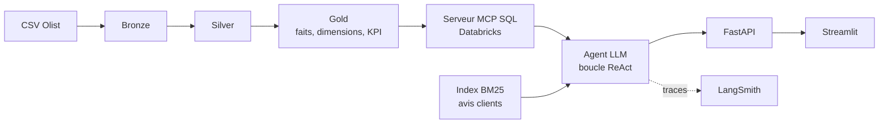

# Olist Data Agent : agent text-to-SQL sur une plateforme Databricks

Un agent LLM qui répond en langage naturel à des questions sur des données e-commerce (Olist), en interrogeant une couche **gold** construite sur **Databricks** (architecture médaillon), avec recherche d'avis clients par **BM25**, garde-fous, observabilité **LangSmith**, évaluation sur un golden set, API **FastAPI**, interface **Streamlit** et CI/CD **GitHub Actions**.

> Projet personnel d'apprentissage. Le jeu de données est petit (environ 100 000 commandes) : Databricks est choisi pour l'architecture, la gouvernance (Unity Catalog) et la démonstration d'un pipeline médaillon, pas pour le volume.

## Architecture



- **ETL médaillon** : notebooks Databricks (`databricks/notebooks/`) qui ingèrent, nettoient et modélisent les données en tables Unity Catalog (`workspace.gold`).
- **Agent** : une vraie boucle d'agent. Le LLM choisit les outils, le code les exécute, renvoie les résultats, jusqu'à une réponse finale ou une limite (étapes, appels d'outils, tokens). Pas de workflow figé ni de routeur.
- **Outils** : `run_sql` (SELECT en lecture seule), `create_chart`, `search_reviews` (BM25 sur les commentaires), `ask_user` (demande de précision).
- **Accès aux données** : le serveur **MCP SQL managé de Databricks** (`execute_sql`, `poll_sql_result`) ; le connecteur `databricks-sql-connector` et DuckDB (tests locaux) sont des backends alternatifs, choisis par `SQL_BACKEND`.

## Garde-fous

Appliqués par le code, jamais par le LLM :

- **SQL** : analyse syntaxique avec `sqlglot` ; une seule requête SELECT, tables autorisées uniquement, instructions d'écriture refusées, `LIMIT` imposé.
- **Entrée** : refus des demandes d'écriture (suppression, création de table…), des tentatives d'injection de prompt et des demandes de secrets.
- **Budgets** : nombre d'étapes, d'appels d'outils et de tokens par question.
- **Sortie** : alerte quand un chiffre de la réponse n'apparaît dans aucun résultat d'outil.
- **Avis clients** : traités comme du texte non fiable (injection indirecte possible) : encadrés par des balises, nettoyés, et le prompt interdit d'obéir à leur contenu.

## Observabilité

- **LangSmith** : trace de chaque question avec les appels LLM et outils imbriqués. Les configurations et secrets sont retirés des entrées tracées.
- **Journal local** `runs/runs.jsonl` : latence totale, temps LLM, temps des outils, tokens, étapes. Exposé par `/runs` et `/stats` (moyenne, p50, p95) et affiché dans le dashboard.

## Évaluation

Le golden set (`agent/eval/golden_set.json`) contient **64 questions** : 45 SQL, 10 demandes à refuser, 4 questions sans réponse possible dans les données, 5 questions sur les avis. Il est séparé en `dev` (réglage du prompt) et `test` (jamais utilisé pour régler).

- **Execution Accuracy** : le SQL de référence et celui de l'agent sont exécutés et leurs résultats comparés (ordre des lignes et colonnes en plus ignorés). C'est la métrique standard du text-to-SQL.
- Autres mesures : taux de refus, taux de réponse « donnée absente », usage de `search_reviews`, latence, tokens, nombre d'étapes, et score global sur les 64 questions.
- Un **intervalle de confiance de Wilson à 95 %** accompagne les taux, et les **erreurs techniques** (quota 429, réseau) sont réessayées puis comptées à part au lieu d'être confondues avec de mauvaises réponses.

| Modèle | Backend | Questions | Score global | Execution Accuracy (SQL) | Refus |
|---|---|---|---|---|---|
| gpt-oss-20b (Groq) | MCP | 64 | X % | X % (45 questions) | X % |

*(à compléter avec le dernier benchmark : `python -m agent.eval.evaluate`)*

Limites : les 64 questions sont écrites par l'auteure sur un seul schéma, donc ces scores ne sont pas comparables à ceux de Spider ou BIRD. La latence mesurée avec l'offre gratuite d'un fournisseur reflète surtout ses limites de débit.

## API

| Route | Rôle |
|---|---|
| `POST /ask` | Pose une question à l'agent (réponse, SQL, graphiques, latences, tokens) |
| `POST /tools/{nom}` | Appelle un outil directement (même garde-fous) |
| `GET /results/{result_id}` | Contenu d'un résultat SQL |
| `GET /charts/{fichier}` | Image d'un graphique |
| `POST /guard/input`, `POST /guard/sql` | Teste les garde-fous |
| `GET /runs`, `GET /stats` | Journal et statistiques |
| `GET /health` | État (backend, modèle, LangSmith) |

## Dashboard Streamlit

Chat avec l'agent (réponse, tableau, SQL, graphiques, clarifications), latence et traces, banc d'essai des outils et garde-fous, et résultats du benchmark.

## Installation et lancement

```bash
python -m venv .venv
.venv\Scripts\activate            # Windows (source .venv/bin/activate sous Linux/macOS)
pip install -r requirements-dev.txt
cp .env.example .env              # puis renseigner les clés (ne jamais committer .env)
```

Variables principales (`.env`) : `LLM_BASE_URL`, `LLM_API_KEY`, `LLM_MODEL` (tout fournisseur compatible OpenAI), `SQL_BACKEND` (`mcp`, `databricks` ou `duckdb`), `DATABRICKS_SERVER_HOSTNAME`, `DATABRICKS_HTTP_PATH`, `DATABRICKS_TOKEN`, `TABLE_PREFIX`, et optionnellement `LANGSMITH_TRACING`, `LANGSMITH_API_KEY`, `LANGSMITH_PROJECT`.

```bash
python -m scripts.build_reviews_index     # index BM25 des avis (une fois)
uvicorn api.main:app --reload             # API sur http://127.0.0.1:8000 (docs : /docs)
streamlit run dashboard/app.py            # dashboard sur http://localhost:8501
python cli.py "Quel est le chiffre d'affaires par mois en 2017 ?"
```

Avec Docker : `docker compose up --build` (l'index des avis n'est pas dans l'image).

Évaluation :

```bash
python -m agent.eval.evaluate --check-gold                          # vérifie les SQL de référence
python -m agent.eval.evaluate --models groq-gpt-oss-20b --split test
python -m agent.eval.evaluate --models groq-gpt-oss-20b,gemini-flash
```

Les profils de modèles sont dans `agent/eval/models.json` (seul le nom de la variable de clé y figure).

## CI/CD

Le workflow `.github/workflows/agent-ci.yml` s'exécute à chaque push et pull request :

1. vérifie que `.env` n'est pas suivi par git ;
2. lint avec `ruff` ;
3. tests `pytest` (faux LLM et DuckDB, aucun secret requis) ;
4. sur `main` uniquement : construction et publication des images Docker `api` et `dashboard` sur **ghcr.io**.

Les images sont publiées mais ne sont déployées nulle part.

## Structure

```
agent/          boucle d'agent, outils, garde-fous, prompts, backends SQL (MCP, Databricks, DuckDB), BM25
agent/eval/     golden set, script d'évaluation, profils de modèles, résultats
api/            API FastAPI
dashboard/      interface Streamlit
scripts/        connexion, tests LLM/MCP/LangSmith, construction de l'index des avis
databricks/     notebooks bronze, silver, gold
tests/          tests unitaires (faux LLM, DuckDB)
.github/        CI/CD
```

## Limites connues

- Jeu de données petit : ne pas lire ce projet comme un cas « big data ».
- Le serveur MCP SQL de Databricks est en bêta (asynchrone, résultats tronqués) ; l'index des avis est donc construit avec le connecteur.
- BM25 est lexical : il ne comprend pas les synonymes. Une recherche sémantique (embeddings) serait la suite naturelle.
- Les modèles gratuits ont des quotas stricts et ne sont pas parfaitement déterministes : les scores varient légèrement d'une exécution à l'autre.
- Les questions du golden set sont peu nombreuses : lire les intervalles de confiance, pas seulement les moyennes.
