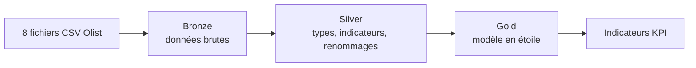

# Olist Lakehouse : pipeline Bronze / Silver / Gold sur Databricks

Pipeline de données de bout en bout sur le jeu de données e-commerce brésilien **Olist** (environ 100 000 commandes), construit en **architecture médaillon** sur Databricks (tables Delta, Spark SQL).

Ce projet met en pratique les notions de lakehouse, de qualité et de gouvernance des données : les anomalies de la source sont **détectées, marquées et documentées**, et non supprimées.

## Architecture



| Couche | Rôle | Schéma Databricks |
|---|---|---|
| **Bronze** | Copie brute des CSV, tout en texte, avec la date de chargement | `workspace.bronze` |
| **Silver** | Types corrects, indicateurs `flag_...` pour chaque anomalie, noms de colonnes corrigés, aucune ligne supprimée | `workspace.silver` |
| **Gold** | Tables prêtes pour l'analyse : faits, dimensions et indicateurs | `workspace.gold` |

### Tables

| Couche | Tables |
|---|---|
| Silver | `silver_orders`, `silver_customers`, `silver_order_items`, `silver_products`, `silver_order_reviews` |
| Gold (faits) | `fact_orders` (une ligne par commande), `fact_order_items` (une ligne par article) |
| Gold (dimensions) | `dim_customers` (une ligne par personne), `dim_products` |
| Gold (indicateurs) | `kpi_monthly_revenue`, `kpi_state_delivery`, `kpi_delay_vs_review`, `kpi_category_revenue`, `kpi_monthly_category_revenue` |

## Décisions de conception

| Décision | Justification |
|---|---|
| Garder toutes les lignes anormales et les marquer | Ce sont de vraies commandes : les supprimer fausserait le chiffre d'affaires |
| `silver_orders` reçoit `customer_unique_id` et garde `customer_id` | Jointure un pour un vérifiée ; la traçabilité reste possible |
| `fact_orders` utilise `customer_unique_id` comme clé vers `dim_customers` | Une personne passe plusieurs commandes |
| `fact_orders` garde l'adresse de livraison de chaque commande | 252 personnes ont plusieurs adresses ; l'adresse appartient à la commande |
| Chiffre d'affaires calculé depuis `order_items` (prix, sans les frais de port) | Les 380 écarts de paiement ne l'affectent pas |
| Agréger avant de joindre | Une jointure directe entre articles et paiements gonfle le chiffre d'affaires de 617 471,64 |

Les décisions sont détaillées dans [`docs/adr/`](docs/adr/).

## Qualité des données : ce qui a été trouvé

L'exploration ([`ingestion/01_exploration_olist.ipynb`](ingestion/01_exploration_olist.ipynb)) a révélé les anomalies suivantes, toutes traitées en « marquer et documenter » :

| Table | Anomalie | Lignes |
|---|---|---|
| `orders` | Remise au transporteur avant l'approbation | 1 359 |
| `orders` | Remise au transporteur avant l'achat | 166 |
| `orders` | Livraison client avant l'approbation | 61 |
| `orders` | Livraison client avant la remise au transporteur | 23 |
| `orders` | Statut `delivered` sans date de livraison | 8 |
| `orders` | Statut `canceled` avec une date de livraison | 6 |
| `order_reviews` | `review_id` en double | 789 clés, 814 lignes en trop |
| `order_payments` | Écarts entre le total des articles et le total payé | 380 |
| `products` | Produits sans catégorie | 610 |
| `products` | Catégories sans traduction | 2 (13 produits) |

## Contrôles de réconciliation (Gold)

| Contrôle | Résultat |
|---|---|
| `fact_orders` : lignes et commandes distinctes | 99 441 |
| `fact_orders` : articles | 112 650 |
| Chiffre d'affaires Gold = chiffre d'affaires Silver | 13 591 643,70, identique |
| `dim_customers` : personnes | 96 096 |
| `dim_products` : produits | 32 951 |
| Chiffre d'affaires des ventes, KPI = `fact_orders` | 13 494 400,74, identique |
| Commandes livrées par état, par groupe de retard et dans `fact_orders` | 96 470 pour les trois |
| `fact_order_items` : lignes et clés (`order_id`, `order_item_id`) distinctes | 112 650 |
| `fact_order_items` : chiffre d'affaires = Silver | 13 591 643,70, identique |
| Chiffre d'affaires des ventes par catégorie, par mois et catégorie, et KPI mensuel | 13 494 400,74 pour les trois |
| Somme des parts de chiffre d'affaires par catégorie | 100,0 % |


## Un résultat métier

Plus la livraison dépasse la date estimée, plus la note du client baisse (corrélation, pas preuve de cause) :

| Retard | Commandes | Note moyenne |
|---|---|---|
| À l'heure ou en avance | 89 936 | 4,29 |
| 1 à 3 jours | 1 870 | 3,29 |
| 4 à 7 jours | 1 802 | 2,10 |
| 8 jours et plus | 2 862 | 1,70 |

Les cinq premières catégories représentent 39,8 % du chiffre d'affaires des ventes :

| Catégorie | Articles vendus | Chiffre d'affaires | Part |
|---|---|---|---|
| `health_beauty` | 9 634 | 1 255 695,13 | 9,31 % |
| `watches_gifts` | 5 970 | 1 198 185,21 | 8,88 % |
| `bed_bath_table` | 11 097 | 1 035 964,06 | 7,68 % |
| `sports_leisure` | 8 590 | 979 740,92 | 7,26 % |
| `computers_accessories` | 7 781 | 904 322,02 | 6,70 % |

Deux définitions du chiffre d'affaires coexistent : **13 591 643,70** (tous les articles) et **13 494 400,74** (ventes seules, hors commandes `canceled` et `unavailable`). Cette dernière est la définition provisoire utilisée par les KPI.

## Exécuter le projet

1. Télécharger le jeu de données [Brazilian E-Commerce Public Dataset by Olist](https://www.kaggle.com/datasets/olistbr/brazilian-ecommerce) sur Kaggle. La table `geolocation` n'est pas utilisée.
2. Dans Databricks, créer les schémas `bronze`, `silver` et `gold`, puis déposer les 8 CSV dans le volume `/Volumes/workspace/bronze/raw`.
3. Importer les notebooks de [`databricks/notebooks/`](databricks/notebooks/) et les exécuter dans l'ordre : `bronze/`, puis `silver/` (02 à 06), puis `gold/` (10 à 15).

## Structure du dépôt

```
databricks/notebooks/   notebooks Bronze, Silver et Gold
ingestion/              exploration initiale des données (en local, avec DuckDB)
docs/                   décisions (ADR), dictionnaire de données, journal d'apprentissage
```

## État d'avancement

| Étape | État |
|---|---|
| Exploration et qualité des données | Terminé |
| Pipeline Bronze, Silver, Gold | Terminé |
| Gouvernance (dictionnaire, lineage, pseudonymisation) | Prévu |
| Ingestion Azure (ADLS Gen2, Data Factory) | Prévu |
| Intégration continue | Prévu |

## Limites

- Olist est un jeu de données déjà anonymisé : la gouvernance sera traitée comme un exercice de mise en situation.
- La définition d'une « vente » est provisoire et sera figée dans un ADR.
- Le projet utilise l'offre gratuite de Databricks, dont les conditions peuvent évoluer.
